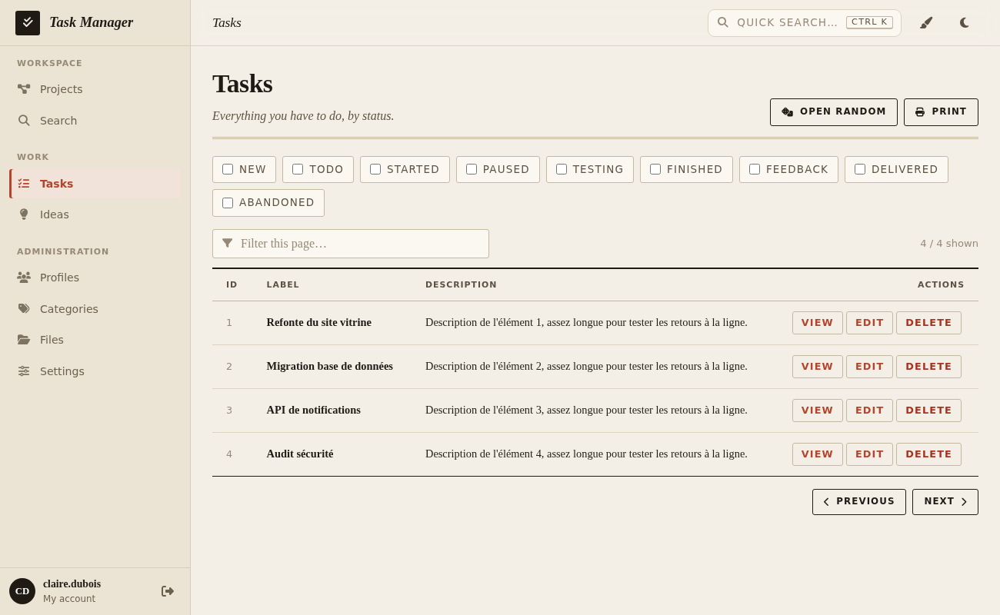

# Task Manager V3

**An app for task Management**

For users :

	You can install it :
		Either from the sources (On a server or i don't know) :
			- Cloning the repository
			- Installing GC_tk on your system and adding the cores directory to your path (Get it there : https://mega.nz/file/pltWlKrb#l1Ors7EEmHEVJdizA_S190gJjxSU67CNmctVks0PufY for linux or https://mega.nz/file/kktGSDxR#Mprq1S57ILIH7CxAFkx6eFyqea0rAreP9dHDMrYMcYA for windows)
			- Access the root directory (where you can access home.ch) and run "GC_tk" in your terminal.

		Either through the GC. Launcher App Store
			- Access the online repository
			- Search for "Task Manager"
			- Click on Donwload
			- You can install it and it will appear in Installed apps tab

			!! Alert : Be carefull using GC. Launcher 2 or less with this app since it has no GUI. I highly recommand to click on "Create Shortcut" for it to make a .desktop file in the home directory. You can now place it on your desktop and then edit it to enable terminal.
			If you run it directly from Launcher, it will freeze (The server will start but since no terminal is shown, you won't be able to controll or stop it.)
			The Issue might be fixed with Launcher > v2.

	Access to the app :
		http://localhost:6102

	Default username : admin
	Default password : Akatsuk1@dw!n

For devs :

	Please help us build this app, fork it and make pull requests.
	Thanks for your contribution !

The admin
gcenterburkina@gmail.com
